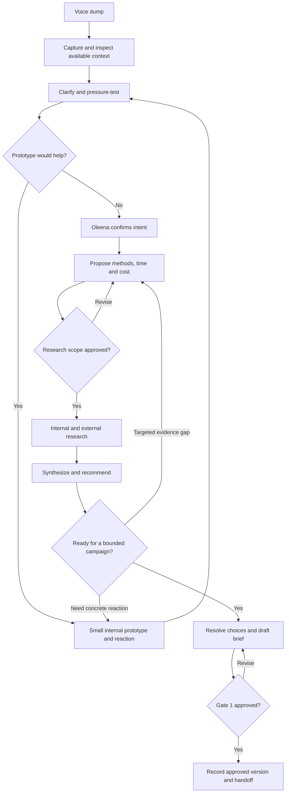

# Campaign brief creation

Scope: rough idea through approved Gate 1 brief. This expands Gate 1; later production gates remain unchanged.

## Owners and outputs

| Stage | Owner | Output / completion |
| --- | --- | --- |
| Capture | Chief of Staff | intake.md preserves the voice transcript; unclear names/numbers are confirmed |
| Clarify | Chief of Staff with Oleena | intent.md captures goal, why, hypotheses, commitments, constraints and questions; Oleena confirms it |
| Prototype | Assigned worker | prototypes/ contains the smallest useful offer card, sample, outline or mock; reaction is logged |
| Research scope | Research worker, coordinated by Chief of Staff | research/plan.md states decision questions, methods, sources, time and cost limits; Oleena approves |
| Research | Research worker | research/findings.md records sourced observations and limitations; research/summary.md explains implications |
| Decide and draft | Marketing Lead with Oleena | decisions.md records choices; brief.md uses the campaign brief template |
| Review | Chief of Staff and Oleena | Completed checklist, recommendation and version-specific approval in campaign-record.md |

Use the discovery, research and brief skills in skills/README.md. Assign actual workers, not just role names. Start with the existing Chief of Staff and one research worker; Marketing Lead may be the same agent.

## Key rules

- Prototype-maxxing: when further discussion is unlikely to clarify a choice, propose or build a small reversible internal example. Respect existing per-run heavy-production rules; ask for that specific run if needed. Never publish a prototype implicitly.
- No knowledge base is required. Inspect what exists, record gaps, and create only useful campaign context. Do not fill blanks with invented customers, results or brand rules.
- Scope an initiative into a bounded campaign. If the offer is uncertain, define an offer hypothesis and the decision the experiment should unlock.
- Research is decision-led. Approve the approach, estimated active/elapsed time, model/API/tool budget and enforceable limits before starting. Stop at limits; return partial findings and options. Research approval is not media-spend approval.
- Record available usage honestly. When hard dollar enforcement is unavailable, disclose that and agree enforceable run/tool limits instead.
- Bring evidence back before settling the direction. Recommend alternatives and tradeoffs. Material changes to confirmed intent require reconfirmation; new research requires a revised approved scope.
- Save internal links instead of copying canonical documents. Separate observations, inferences and assumptions. Public competitor activity does not prove campaign performance.
- Questions can remain as explicit experiment hypotheses. Blocking gaps in offer, measurement or ownership must be settled before approval.
- Use decisions.md for simple campaigns. Introduce Wayfinder decision tickets only when session length and dependencies warrant them. Keep the map campaign-scoped.

## Campaign folder

Use campaigns/<id>-<slug>/ with intake.md, intent.md, decisions.md, campaign-record.md, brief.md, research/{plan,findings,summary}.md and prototypes/ as needed. Create from templates only when the stage requires them; do not create blank placeholders unnecessarily. One parent issue can link this folder; it is an index, not a competing status record.

## Approval packet

Present exact output paths/revisions, recommendation, evidence, unresolved choices, checks, and the next action. Record person, date, decision, scope and version in campaign-record.md. Approval of intent is not approval of the offer; approval of research is not approval of production; Gate 1 approval does not waive the existing per-run production or launch rules.

## Brief review checklist

- Objective and learning decision are clear.
- Audience, problem, offer, CTA and channel form a coherent journey.
- Claims have evidence; uncertainty is labelled.
- Experiment specifies what changes and what stays stable.
- Primary metric, qualification, data source, evaluation window and decision rules are explicit.
- Clicks/signups/purchases are interpreted at their actual evidentiary strength.
- Deliverables, owners, dependencies, time and budget are feasible.
- Sources, major decisions and prototype feedback are linked.
- Approval references the reviewed version; no production starts prematurely.
