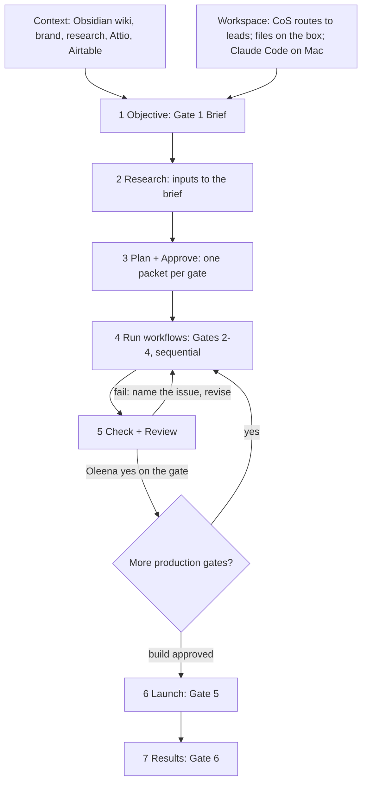

# Campaign workflow (as it works today)

_Last updated 2026-11-17. Describes the live process in [oleenamak/team-playbooks](https://github.com/oleenamak/team-playbooks) and the one campaign run through it so far, CBO-001. This follows a reference operating model (Workspace, Context, Campaign Workflow, Check+Revise) but only includes what exists now. Gaps are marked **Not yet**._

## Workspace

| Piece | What exists today |
| --- | --- |
| Playbooks | `playbooks/CONVENTIONS.md`, `playbooks/campaign-playbook.md`, `playbooks/landing-pages.md` |
| Templates | `templates/campaign-brief.md`, `templates/taste-loop.md` |
| Campaign state | One `campaign-record.md` per campaign on the box (`/workspace/campaigns/...`). Chat is not the record. |
| Production | Heavy production goes to Claude Code on Oleena's Mac (`--model sonnet`), with her approval for each run. |
| People | Oleena talks only to Chief of Staff, who routes work and owns the review queue. Marketing Lead: brief and copy. Creative Lead: design. Engineer Lead: build, tracking, launch setup. Product Lead: can cover analysis with CoS. GTM Lead is a separate outreach workflow, not part of CBO-001 production. |
| Approver | Oleena. Nothing is sent, published, merged, shipped, or spent without her explicit yes. An approved deliverable is still a draft until she authorizes the action. |

**Not yet:** Analyst Lead (playbook: TBD; CoS or Product Lead would cover Gate 6). Multica (listed in the playbook as not connected). A Campaign Tracker Sheet is named in the playbook tools table but is not the live system of record; CBO-001 state lives in `campaign-record.md`.

## Context

**Internal / company brain**

- Oleena's Obsidian LLM wiki is the knowledge base.
- Brand, positioning, and research live in the campaign project (for CBO: `01-strategy/positioning.md`, `03-brand/`, `02-research/`).
- Team conventions, landing-page rules, and taste-loop checks live in the GitHub repo.

**External**

- Research sources and competitor scans collected into the campaign's `02-research/` folder.
- Meta Ads Manager is the planned source for spend and delivery. **Not yet in use** — no ads have run.

**Systems**

- **CRM:** Attio. No Notion, no Excel. Attio is not the campaign system of record.
- **Sign-ups:** Airtable base `appyvSg2j38dZZoIs` (Chief Bets Officer), table Founding Sign-ups. Automation is off. The form-to-Airtable path still needs a confirmed test submit before launch.
- **Data warehouse:** **Not yet.**
- **Hosting, domain, and Meta Pixel:** planned for the paid landing page. **Not yet authorized.**

## Campaign workflow

CONVENTIONS.md defines four production gates, in order, each needing Oleena's yes before the next starts: **1 Brief → 2 Copy → 3 Design → 4 Build**. The campaign playbook adds **Gate 5 Launch** and **Gate 6 Analyze**. CBO-001 uses that combined numbering.



### 1. Objective — Gate 1 Brief

Marketing Lead drafts the brief from `templates/campaign-brief.md`: objective, audience, hypothesis, offer, channels, budget, success metrics, and open questions. Chief of Staff opens the campaign record and presents one review packet. Oleena approves, requests changes, or stops. Brief approval authorizes production only, not launch or spend.

**CBO-001:** Brief v3 approved 2026-11-13, 2:37 PM CT. Objective: test whether Chief Bets Officer can acquire interested owner-operators and tradespeople (about 30–65+) via Meta ads. Angles: A, "Become a founding member, free"; B, "2027 Big Bets" sessions. Proposed budget $500–$750, not authorized.

### 2. Research

Not a numbered gate. Research happens before and during the brief and is stored with the campaign. Findings may inform the hypothesis; they do not invent proof, member counts, or testimonials. CBO has not run ads, so there is no performance baseline.

**CBO-001:** `02-research/` holds the original brief, competitor scan, community models, sources, and reference-site screenshots.

### 3. Plan + Approve

One consolidated approval request per gate: deliverable links and versions, recommendation, open decisions, and the decision asked for (approve / request changes / stop). Approval is recorded against a specific version, with approver and date. Silence is not approval. If later feedback changes audience, offer, message, budget, or scope, the earlier gate is reopened before that work continues.

### 4. Run workflows

Production runs **in sequence**, not as parallel channel tracks.

- **Gate 2 Copy** — Marketing Lead. Ad copy and landing-page copy. Approved copy is the source of truth; the build may not quietly rewrite it.
- **Gate 3 Design** — Creative Lead. Visual directions, then production-ready mockups. Landing pages get an `architecture.md` section plan before the build (page job, section list, friction budget, ad-promise text).
- **Gate 4 Build** — Engineer Lead. Preview or staging deploys only. A production deploy needs a separate yes.

**Parallel channel tracks: Not yet.** CBO-001 has one acquisition channel: Meta ads (Facebook and Instagram) to a rebuilt landing page with a native form. Angles A and B are a planned budget split inside that channel, not separate channel workflows.

**CBO-001:** Gate 2 copy v2 (`ad-copy-v2.md`, `landing-page-copy-v2.md`) approved 2026-11-13, 3:34 PM CT. Gate 3 is in progress in Oleena's own Claude conversation; illustrated rounds 2–11 were rejected. Engineer Lead has started a build from approved copy v2 while design is still open.

### 5. Check + Review

Chief of Staff checks completeness and alignment, then puts work in Oleena's review queue. Leads run the Check+Revise loop (below) before handing work back. Oleena approves, requests changes, or stops.

### 6. Launch — Gate 5

A launch packet should confirm approved assets and destinations, a tested form path, tracking, targeting, budget, a monitoring owner, and a pause or rollback. Authorization must name the exact channels, assets, audience, budget, and schedule. Creative approval is not launch authorization.

**Not yet run.** Pending Oleena's yes on CBO-001: Airtable automation, hosting, domain, Pixel, and spend. The form must write submissions to Airtable before any spend. Target launch date is TBD.

### 7. Results — Gate 6

Planned: pull results for a set window, compare the primary KPI to the target, use supporting metrics to diagnose the funnel, and recommend stop, iterate, or scale. Airtable rows are the planned source of truth for sign-ups; Meta click and Lead counts are supporting. Do not declare success from early CPM or a handful of cheap leads.

**Not yet run.** No live URLs, spend, or results. Evaluation date TBD. **Analyst Lead: Not yet.** **Data warehouse: Not yet.**

## Check + Revise loop

```
create work
    → check against the approved brief / copy / architecture
    → run taste-loop and (for pages) pre-ship checks
         → all yes: pass to CoS review queue → Oleena
         → any no:  name the issue → revise → recheck
```

Do this silently. Do not show scores or skill names in the deliverable.

**Taste-loop checks in use** (`templates/taste-loop.md`): avoid flat beige or AI-looking backgrounds; avoid photorealism; follow the risograph style in `03-brand/brand-sheet.html`; keep it simple; respect gate order; mark work as a draft. New checks come only from Oleena's real corrections.

**Landing-page pre-ship checks** (`playbooks/landing-pages.md`): rendered text matches approved copy verbatim; 5-second test passes at 375px (what it is, who it's for, what to do next); the ad's promise appears word for word on the first screen; the built page matches `architecture.md`; friction budget holds; preview only; the deliverable states what needs her yes.

**Stop conditions**

- Oleena can stop at any gate.
- Do not skip gates.
- Reopen the earlier gate if a later change hits audience, offer, message, budget, or scope.
- Nothing is sent, published, merged, or spent without a yes for that exact action.
- CBO-001 cannot launch while Airtable automation is off, the form path is unproven, or hosting, domain, Pixel, and spend are unauthorized.
- Brief "scale / iterate / stop / inconclusive" criteria exist as proposed defaults. They are uncalibrated and unused until there are results.
